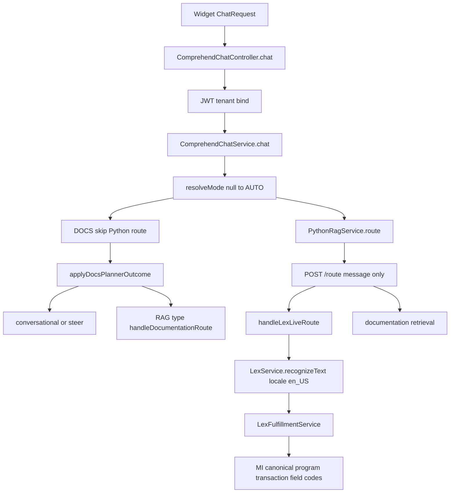

# P0 overall architecture — multilingual support

Status: architecture document complete. Multilingual support is **not** complete. No runtime behavior changes with this note.

This document records how the current M3 Bot pipeline works and where a locale would be inserted later. It does not enable `de_DE`.

## Scope of this note

Unchanged by this task:

- `ComprehendChatService`
- `ChatRequest`
- `LexService`
- `m3-rag-system-py/services/nlp/query_router.py`

There is no `ChatApiRequest` class. The widget body is `ChatRequest`. The Homepages file `m3-field-selection.ts` is not in this workspace, so widget behavior is **Unknown — requires the widget repository**.

## 1. Existing request flow

Evidence:

- Entry: `ComprehendChatController.chat` checks the JWT scope, then `TenantClientBindingService.assertAuthorizedForTenant`, then `ComprehendChatService.chat`.
- Mode: `resolveMode` returns `request.getMode()`, or `AUTO` when mode is null. Wire values stay `auto`, `m3`, `docs` (`ChatMode`).
- DOCS skips Python `/route`. `applyDocsPlannerOutcome` then:
  - `RAG` goes to `handleDocumentationRoute` (handler `documentation/retrieval`).
  - `CONVERSATIONAL`, `NON_M3`, and `LIVE_M3` stay on planner replies or steer messages. They do not call Lex or MI.
- AUTO and M3 call `resolvePythonRouteValue`, which posts the original user text through `PythonRagService.route`.
- `PythonRouteRequest` today contains only `message`. Adding `locale` is a future change, not part of this document.
- Python `POST /route` calls `query_router.route_query` and returns only `live` or `rag`.
- Lex runs only after route `live`, inside `handleLexLiveRoute`, with `originalUserText`. `LexService.recognizeText` sets `localeId` from `LexProperties` (`lex.locale-id=en_US` in `application.properties` and `application-prod.properties`).
- Fulfillment (`LexFulfillmentService` plus `IntentApiCatalog`) builds the MI call from the intent name and extracted slot parameters. The raw sentence is not the MI payload.
- PII today is English only: `ComprehendServiceImpl` uses `languageCode("en")`. Presidio analyzes with `language="en"` and spaCy `en_core_web_lg`.

## 2. Locale contract

| Item | Decision |
| --- | --- |
| Locale ids under consideration | `en_US`, `de_DE` |
| Default and fallback | `en_US` |
| Representation | Lex-style locale id, independent of chat mode |
| Current request field | None. `ChatRequest` has no locale. |
| Current Python route body | `{ "message" }` only |
| Current Lex locale | Process property `lex.locale-id`, always `en_US` |

Future (not implemented): optional `locale` on `ChatRequest` and on `PythonRouteRequest`. The router still returns only `live` or `rag`.

## 3. Language precedence

Resolve one locale per turn, after mode is known, before Python or Lex is called.

1. Saved user preference, once the widget stores one.
2. Explicit `locale` on this request, if the widget sends it.
3. Detected message language, only when both 1 and 2 are absent. Detection must not run on identifiers alone.
4. Tenant default, only if one is added later. None exists now.
5. `en_US`.

An unknown or unsupported saved preference or explicit locale resolves to `en_US`. It does not fall through to detection. Detection must not override a saved or explicit locale.

## 4. Locale is not mode

`auto`, `m3`, and `docs` stay the only chat modes. `live` and `rag` stay the only route values. A German utterance may still use any supported mode. Do not add a language mode and do not accept `"mode": "live"`.

## 5. Original text and identifiers

Keep `userMessage` unchanged for Lex recognition and any later language-aware step.

Do not translate:

- M3 program codes (`OIS100`, `PMS100`, `CRS610`)
- MI field codes (`MFNO`, `FIDT`, `CUNO`, and the rest of the catalog)
- Order numbers and customer ids, including leading zeros (`0003000307`)

MI receives the canonical operation (program and transaction from `IntentApiCatalog`), field codes, and extracted parameter values. It does not receive the raw natural-language sentence as the API payload.

Optional translation later is for RAG search against English documents only. It is not part of the live Lex or MI path.

## 6. Security boundary

Locale must never:

- select a tenant
- bypass JWT authentication
- change `assertAuthorizedForTenant`
- be read from the tenant-auth bypass header as an identity
- change quota or session authorization
- be added to the Lex session key, which stays `tenant:user:session`

Authentication and tenant binding stay as they are.

## 7. Language capability

Listing a locale does not enable it. `en_US` is the only locale the running system uses.

| Locale | Lex | Router phrases | PII | RAG | Widget UI | Enabled |
| --- | --- | --- | --- | --- | --- | --- |
| `en_US` | `lex.locale-id=en_US` | English patterns in `query_router.py` | Comprehend `en`, Presidio `en` | English retrieval path | Unknown (widget not in this repo) | Yes, implicit |
| `de_DE` | Not selected by Spring | No German phrase pack | Not verified | No locale on retrieval | Unknown | No |

### de_DE stays disabled until all of these pass

- Lex `de_DE` is built on the same bot and alias, with the same intent and slot names as `IntentApiCatalog`.
- A router phrase pack lets German live questions return `live`.
- A PII path for German is verified. Do not assume Amazon Comprehend `DetectPii` supports German because the application lists `de_DE`. Confirm the service. If it does not, use a tested Presidio German model or another explicitly defined fallback.
- End-to-end tests for that locale pass.

Mapping a locale to a PII language code is a future insertion point. It is not a claim that German PII works.

## Future insertion points (not implemented)

- Resolve `resolvedLocale` in `ComprehendChatService.chat` immediately after `resolveMode`, using the precedence and fallback rules above.
- Add optional `locale` on `ChatRequest` and, later, on `PythonRouteRequest`.
- Pass that locale into `LexService.recognizeText` and `putSessionAttributes` instead of `LexProperties.getLocaleId()`.
- After PII support is verified, map the locale to the Comprehend or Presidio language. Until then, German PII stays off.
- Pick Spring fallback and steer strings by locale after the route is known.
- Do not add a locale argument to `IntentApiCatalog` or MI builders.

## Checklist

| Check | Result |
| --- | --- |
| 1. Request flow mapped | Documented above. Widget file not in this repo. |
| 2. Locale contract | `en_US` / `de_DE`, default `en_US`. Not on the wire today. |
| 3. Precedence and fallback | Agreed in this note. Not implemented. |
| 4. Locale separate from mode | Agreed. Current modes already have no language. |
| 5. Original text and identifiers | Original text for Lex. MI gets canonical operations and parameters. |
| 6. Security boundary | Locale must not affect auth, tenant, quota, or Lex session identity. |
| 7. Capability configuration | Only `en_US` is in use. `de_DE` is gated. |

Overall architecture documentation: done. Multilingual runtime support: not started.
